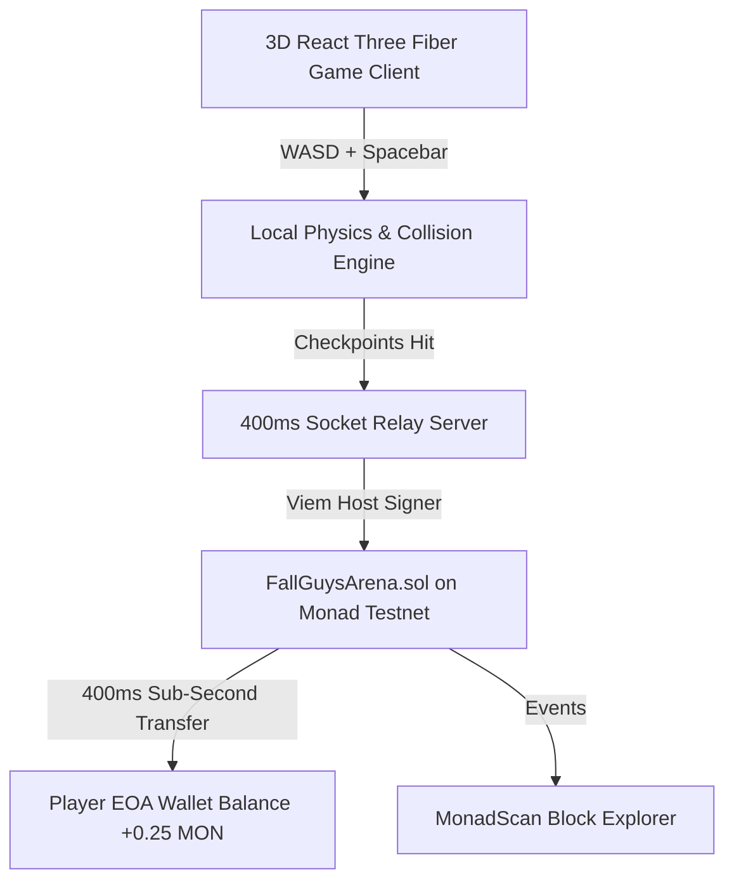

# 🏃‍♂️💨 FALL GUYS ON MONAD — Real-Time 400ms Streaming Payout Battle Arena

> **Built for Monad Blitz Hyderabad V3 (August 22, 2026)**  
> *100-Player 3D Obstacle Course with 400ms Real-Time Streaming Checkpoint Payouts on Monad Parallel EVM.*

---

## ⚡ Live Deployment Links (For Judges & Pitch)

| Resource | Link / Value |
|---|---|
| **Live Contract on Monad Testnet** | [`0xDFAA6355BB05A3a6a247D2F6c5BB4C288AcD39af`](https://testnet.monadexplorer.com/address/0xDFAA6355BB05A3a6a247D2F6c5BB4C288AcD39af) |
| **Monad Testnet Chain ID** | `10143` |
| **RPC Endpoint** | `https://testnet-rpc.monad.xyz` |
| **Contract Source** | [`contracts/src/FallGuysArena.sol`](./contracts/src/FallGuysArena.sol) |
| **Live Local Frontend** | `http://localhost:3000` |

---

## 💡 Why Monad Only? (The Core Innovation)

Traditional blockchains like Ethereum, Arbitrum, or Polygon have 2s–15s block times and high gas fees. It is impossible to execute continuous, zero-latency micro-transfers inside a fast-paced 3D action game.

**On Monad (10,000 TPS, 400ms Sub-Second Block Time, Sub-Cent Gas):**
- **ZERO CLAIM BUTTONS**: When a player runs through a checkpoint gate in the 3D physics world, the smart contract **instantly transfers native MON directly into the player's wallet within 400ms**!
- As you physically navigate moving platforms and rotating hurdles, your real-world wallet balance ticks upward in real time!
- **OCC-Safe Isolated Storage Architecture**: Every runner's state is stored in disjoint per-player storage mappings, eliminating optimistic concurrency conflicts during 100-player parallel execution.

---

## 🎯 Gameplay & On-Chain Economics

1. **1 MON Entry Fee**: Players pay 1 MON to enter the battle obstacle course.
2. **Instant Direct-to-Wallet Checkpoint Streaming**:
   - 🏁 **Checkpoint 1 (z = -32)**: Smart contract transfers **0.25 MON (25%)** straight to your wallet.
   - 🏁 **Checkpoint 2 (z = -62)**: Smart contract transfers **0.25 MON (50% cumulative)** straight to your wallet.
   - 🏁 **Checkpoint 3 (z = -92)**: Smart contract transfers **0.25 MON (75% cumulative)** straight to your wallet.
   - 👑 **Finish Line (z = -120)**: Smart contract transfers **0.25 MON (100% refund) + Share of Eliminated Runners' Unearned Pool**!
3. **Elimination Protection**: If you fall off at Section 2, you **already received and kept your 0.50 MON** directly in your wallet!

---

## 🏗️ Architecture & Technology Stack



- **Frontend**: Next.js 15, React Three Fiber, Three.js Physics, Vanilla CSS Light Theme, Zustand, Wagmi v2 + Viem.
- **Smart Contracts**: Solidity 0.8.26, Foundry, OpenZeppelin v5, Monad Cancun EVM.
- **Real-Time Layer**: Node.js, Express, Socket.io, 400ms Parallel EVM Relayer.
- **Web Audio Engine**: Zero-latency procedural sound synthesizer.

---

## 🚀 Quickstart & How to Run Locally

### 1. Clone & Install Dependencies
```bash
git clone <repo-url>
cd fall-guys-monad
npm install
cd contracts && forge build
cd ../web && npm install
cd ../server && npm install
```

### 2. Start Services
```bash
# Terminal 1: Relay Server
node server/index.js

# Terminal 2: Web Client
cd web && npm run dev
```

Open **[http://localhost:3000](http://localhost:3000)** in your browser!

---

## 🏆 Verified Monad Testnet Transactions

- **Contract Deployment**: [`0xDFAA6355BB05A3a6a247D2F6c5BB4C288AcD39af`](https://testnet.monadexplorer.com/address/0xDFAA6355BB05A3a6a247D2F6c5BB4C288AcD39af)
- **Automatic Checkpoint Payout (0.25 MON)**: [`0xb9a9e6e3a84a648575ee1093a3c301def008aa83f07bf83d8a63701dd3f310e3`](https://testnet.monadexplorer.com/tx/0xb9a9e6e3a84a648575ee1093a3c301def008aa83f07bf83d8a63701dd3f310e3)
- **Direct Funding Transaction**: [`0xf62a7243333072802ab05bbdf4aa544a2921fe62359d06ae1e669f37d0e30c86`](https://testnet.monadexplorer.com/tx/0xf62a7243333072802ab05bbdf4aa544a2921fe62359d06ae1e669f37d0e30c86)
